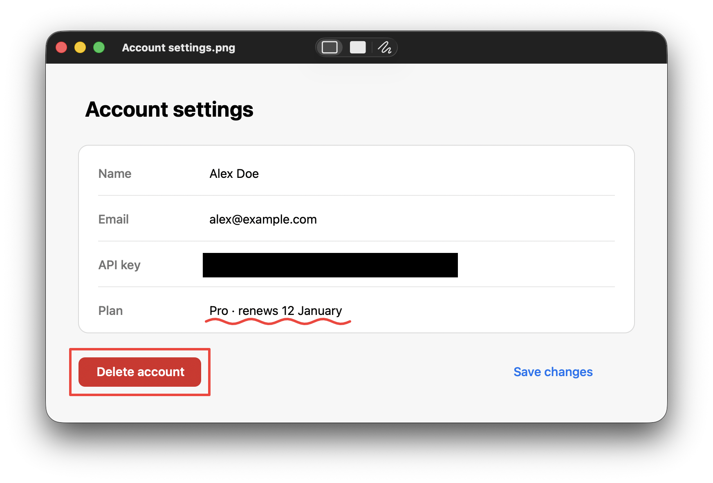

# QuickMark

Minimal native macOS app for marking up screenshots: boxes, filled boxes and freehand.



## Install

Requires macOS 15+.

### Nix

Try it:

```sh
nix run github:syhner/quick-mark
```

Or install it with nix-darwin (appears in `/Applications/Nix Apps`) or Home Manager:

```nix
# flake inputs
quickmark.url = "github:syhner/quick-mark";

# nix-darwin: environment.systemPackages, Home Manager: home.packages
inputs.quickmark.packages.${pkgs.stdenv.hostPlatform.system}.default
```

### From source

Requires the Xcode Command Line Tools.

```sh
git clone https://github.com/syhner/quick-mark.git
cd quick-mark
./install.sh
```

Installs to `~/Applications/QuickMark.app`. Delete it to uninstall.

## Use

Open an image with Finder's Open With, by dragging it onto the Dock icon or the launch window, with Cmd+O, or paste one with Cmd+V.

| Key | Action |
|---|---|
| B | Box |
| F | Filled box |
| P | Pen |
| Cmd+Z / Cmd+Shift+Z | Undo / redo |
| Cmd+S | Overwrite the original (pasted images ask where to save) |
| Cmd+C | Copy the marked-up image |

Closing a window never asks to save.

## Test

```sh
swift run QuickMarkTests
```

Drives the app through real key, mouse, Dock-click and clipboard events. Windows flash on screen while it runs; the clipboard is restored afterwards.

## License

MIT
